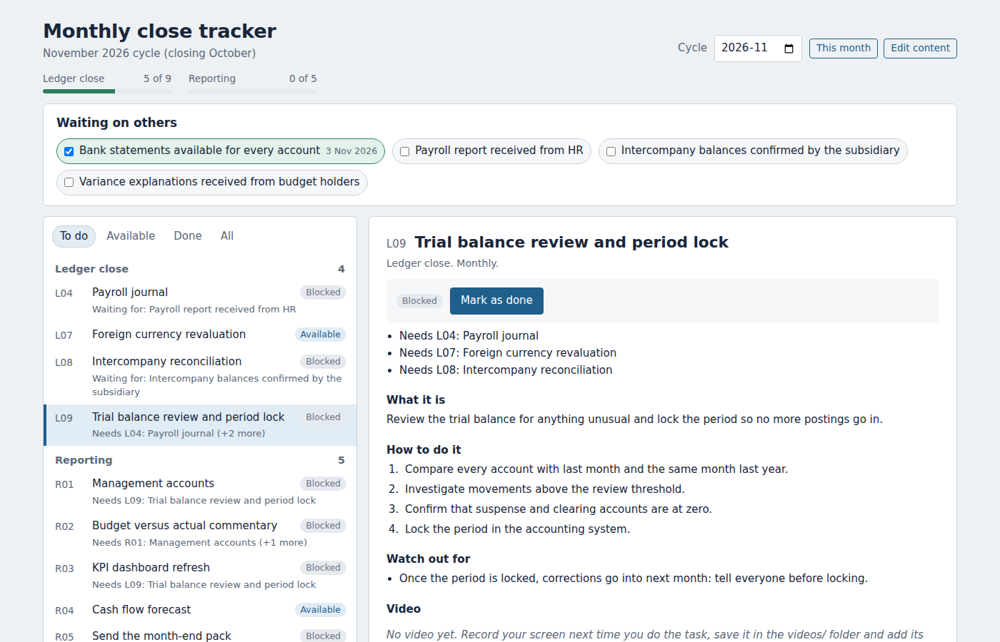

# Monthly close tracker

A single-page tool to run a recurring monthly process. It shows which tasks can be started today, which are blocked and why, and what each task unlocks once it is done. Every task carries its own step-by-step guide, so the tracker doubles as the process manual.

**[Live demo](https://YOUR-USERNAME.github.io/monthly-close-tracker/)**. The content is fictitious: the month-end close of an invented company, Alder & Finch Ltd.

## Why I built it

I run a monthly cycle of financial statistics in which many steps depend on each other and on files or emails from other teams. The order and the dependencies lived in my head, and the procedures were long personal notes. I built this tracker for my team, including a new intern, so that anyone can see where the cycle stands and how each task is done. This repository is a public version with invented content.

## What it does

- **Dependencies.** A task stays blocked until the tasks it depends on are done. Softer "better after" dependencies only show a warning.
- **Waiting on others.** External events, such as a bank statement or a report from HR, unblock tasks when they arrive. The arrival date is logged.
- **Monthly, quarterly and year-end tasks.** Quarterly and year-end tasks only appear in the months where they apply.
- **A guide for every task:** what it is, how to do it, common mistakes, files and folders, and an optional screen-recording video.
- **Content editor.** Tasks can be added, edited, reordered or deleted without touching any code. The editor generates a new `tasks.js`.
- **Content checks.** Duplicate ids, references to tasks or waits that do not exist, and circular dependencies (found with a depth-first search) are flagged at the top of the page.
- **Log.** Completion dates and waits can be exported to CSV, to measure over time when each input usually arrives and how long the close takes.

## How it works

Two files, no libraries, no build step and no server.

| File | Contains |
|---|---|
| `index.html` | The engine: layout, logic and editor |
| `tasks.js` | The content: tasks, dependencies, waits and guides |

Content and logic are kept apart, so the same engine can run any process by swapping `tasks.js`.

Why a `.js` file and not JSON? A page opened from a local or network folder cannot fetch a JSON file sitting next to it, but it can load a script. That way the tracker works by double-clicking it in a shared folder, as well as on GitHub Pages.

Progress is stored in the browser (`localStorage`), per user, and can be saved and restored as a JSON backup.

## Use it for your own process

1. Download the repository and open `index.html`.
2. Click **Edit content** and replace the demo tasks with yours.
3. Click **Download tasks.js** and replace the file next to `index.html`.
4. Optionally, create a `videos/` folder and add screen recordings (`.mp4`) to the tasks.

## Built with AI assistance

I designed the tool and its rules (what counts as a dependency, which events block which tasks, which checks the content must pass) and built it iteratively with Claude, testing each version against my real monthly cycle.

## Limitations

- Progress is kept per browser: there is no shared state between users, because there is no server.
- If two people edit the content at the same time, the last `tasks.js` copied wins.

## License

[MIT](LICENSE)
